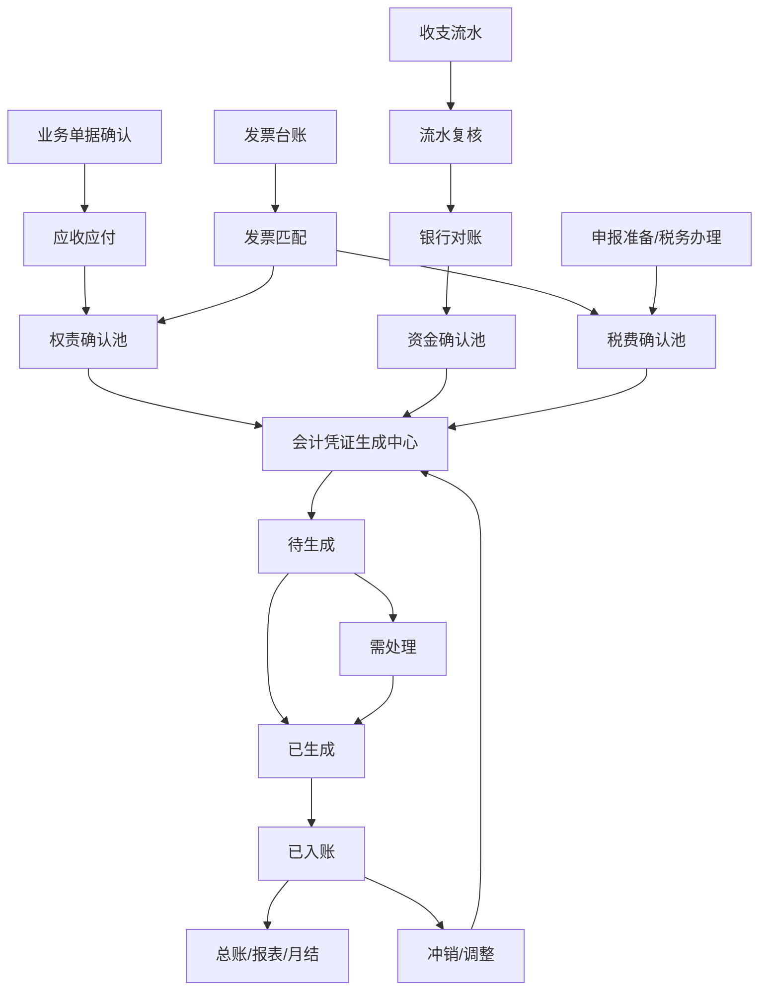

# 会计凭证完整闭环方案 V1

Date: 2026-06-27

Status: frontend_phase5_implemented_backend_contract_expanded

Owner: finance-management frontend scope

## 1. 目标

本方案用于把 `财务管理 / 会计凭证` 从早期前端凭证预览升级为完整的凭证生成闭环方案。

截至 2026-06-28，前端已完成状态硬切、发票税额接入、银行对账前置、税务事项接入、前端会话内入账/冲销模拟和后端扩展契约。后续真实后端实现仍应做不兼容硬切，不保留早期 `草稿` 凭证口径，不继续让 `应收应付` 和 `收支流水` 直接 map 成最终会计凭证。

目标流程要覆盖：

- 应收应付形成权责事实。
- 发票台账提供进销项、税额和开票事实。
- 收支流水提供系统侧收付款事实。
- 银行对账提供银行侧真实发生事实。
- 会计凭证生成中心统一归集以上事实，生成权责凭证、资金凭证、税费凭证、调整凭证和冲销凭证。
- 后续总账、报表、月结只消费已入账凭证。

## 2. 依据和约束

已核对的公开口径：

- 财政部会计司官方解读指出，电子发票、财政电子票据、电子客票、电子行程单、银行电子回单等电子会计凭证逐渐普及，且会计凭证是单位进行会计核算的重要依据。参考：`https://kjs.mof.gov.cn/zhengcejiedu/202004/t20200402_3492561.htm`。

项目内已确认约束：

- 当前项目按湖北武汉小规模纳税人口径推进，增值税及附加方案已在 `docs/governance/vat-declaration-hardcut-plan-v1.md` 中固定。
- 小规模纳税人的进项发票用于成本凭证和内部核对，不作为增值税抵扣项。
- 税务最终申报和缴款结果以电子税务局实际办理结果、回执和缴款凭证为准。
- 当前前端仍是 mock 状态，不具备正式会计凭证、总账、月结、审计级归档能力。

因此，本方案不是法律或审计意见。它是项目内部前端和后续后端接入的业务系统设计基线。

## 3. 当前代码现状

当前 `会计凭证` 相关代码主要在：

- `apps/web/src/features/finance/financeAccountingVoucherModel.ts`
- `apps/web/src/features/finance/FinanceAccountingVouchersPage.tsx`
- `apps/web/src/features/finance/financeReceivablesPayablesData.ts`
- `apps/web/src/features/finance/financeData.ts`
- `apps/web/src/features/finance/financeInvoiceData.ts`
- `apps/web/src/features/finance/financeBankReconciliationModel.ts`

当前前端生成方式：

```text
已确认应收应付 + 发票/未开票/无票事实 -> 权责凭证候选
已入账且已银行对账收支流水 -> 资金凭证候选
已确认税务事项 + 税务回执/缴款事实 -> 税费凭证候选
已入账且已银行对账流水冲正/补差、未解决红票等 -> 调整凭证候选
前端会话内入账 -> mock 正式凭证号 + 派生总账影响
前端会话内冲销 -> 标记已冲销 + 移除派生总账影响
```

当前主要缺口：

- 前端状态和入账/冲销仍是会话内 mock，不是正式会计凭证。
- 会计凭证、凭证分录、来源关系、凭证号序列、期间锁定、事件记录和总账分录已有后端契约，但还没有真实后端持久化。
- 正式凭证号还没有由后端事务内序列表分配。
- 期间关闭和重开还没有真实权限、审批、审计和回滚边界。
- 三张表、总账、明细账和科目余额还没有消费真实 `已入账` 凭证。
- 正式后端 API、数据库 migration、contract tests、发布回滚和恢复演练尚未实现。

## 4. 目标业务分层

完整闭环必须区分以下层级：

```text
业务事实层
合同 / 项目阶段 / 报销 / 薪酬 / 外协 / 税费

权责确认层
应收应付 / 收入成本费用确认 / 往来确认

票税事实层
销项发票 / 进项发票 / 红字发票 / 未开票收入 / 税务申报准备

资金事实层
收支流水 / 流水复核 / 银行流水 / 银行对账

会计凭证层
权责凭证 / 资金凭证 / 税费凭证 / 调整凭证 / 冲销凭证

账簿报表层
总账 / 明细账 / 科目余额 / 三张表 / 月结
```

关键原则：

- 业务确认不是会计入账。
- 发票不是收款事实。
- 银行流水不是业务发生原因。
- 应收应付不是最终会计凭证。
- 会计凭证必须能追溯到来源单据、发票、银行流水和操作记录。

## 5. 目标总流程

本方案按三条事实线推进，最后进入同一套会计凭证体系。

### 5.1 权责线

权责线回答的是：

```text
这笔收入、成本、费用、往来是否已经应该确认？
```

目标流程：

```text
业务发生
  ↓
业务单据确认
  ↓
生成应收应付
  ↓
匹配发票、未开票收入、无票成本、报销单、结算单、工资表等业务事实
  ↓
生成权责凭证候选
  ↓
完整：已生成
不完整：待生成 / 需处理
```

权责凭证的核心来源是 `应收应付`，但不能只看应收应付金额。完整处理时还要看：

- 发票或未开票收入口径。
- 税额或免税/不计税口径。
- 原始凭证。
- 会计科目。
- 来源单据。

### 5.2 资金线

资金线回答的是：

```text
这笔钱是否真实进出公司账户？
```

目标流程：

```text
发生收款/付款
  ↓
生成系统收支流水
  ↓
流水复核
  ↓
导入银行流水
  ↓
银行对账
  ↓
生成资金凭证候选
  ↓
完整：已生成
不完整：待生成 / 需处理
```

本方案中 `资金凭证` 是项目内的业务分类名，用于表示现金、银行存款或对公账户资金变动形成的凭证。实际凭证种类仍可细分为：

```text
收款凭证
付款凭证
转账凭证
```

因此，用户口头说的“现金凭证”在本项目文档中统一称为 `资金凭证`；它的核心是银行存款、现金或对公账户资金事实。

### 5.3 票税线

票税线回答的是：

```text
这笔业务的发票、税额、申报和缴款口径是什么？
```

目标流程：

```text
导入或补录发票
  ↓
发票台账
  ↓
发票匹配
  ↓
申报准备
  ↓
税务办理和回执
  ↓
影响权责凭证、税费凭证或调整凭证
```

发票既不是业务发生本身，也不是资金到账本身。它提供票据和税额事实，主要影响：

- 权责凭证中的收入、成本、费用和税额拆分。
- 税费凭证中的应交、实缴和结转。
- 后续开票、红票、未开票收入和申报差异调整。

### 5.4 统一凭证体系

权责凭证、资金凭证、税费凭证、调整凭证和冲销凭证不是不同账套。

它们最终都进入同一套会计凭证体系：

```text
权责凭证
资金凭证
税费凭证
调整凭证
冲销凭证
  ↓
统一会计凭证列表
  ↓
已入账后进入总账
  ↓
报表和月结
```

凭证类型只是 `会计凭证` 的分类字段，不代表多套账。

### 5.5 汇总流程图



## 6. 会计凭证状态机

完整版本不再使用 `草稿` 作为主状态。目标状态如下：

```text
待生成
需处理
已生成
已入账
已冲销
```

### 6.1 状态定义

| 状态 | 含义 | 是否进入总账 | 是否允许编辑 | 典型来源 |
|---|---|---:|---:|---|
| `待生成` | 来源事实已经存在，但必要前置资料还没满足，系统暂不生成完整分录 | 否 | 不存在凭证编辑，仅处理来源资料 | 已确认应收但发票/未开票口径未完成、已复核流水但银行未对账 |
| `需处理` | 系统尝试生成凭证，但发现科目、金额、来源、票税、银行或原始凭证问题 | 否 | 不能直接改凭证，应回到来源模块处理 | 缺科目、缺原始凭证、发票金额不匹配、银行对账异常 |
| `已生成` | 分录已生成且规则校验通过，但尚未过账到总账 | 否 | 可重新生成或撤回生成，需保留操作记录 | 权责、资金、税费、调整凭证生成结果 |
| `已入账` | 凭证已正式写入账簿消费边界 | 是 | 不允许编辑，只能冲销或补充调整 | 总账、报表、月结来源 |
| `已冲销` | 原凭证已被冲销凭证抵消，保留历史和关联关系 | 原影响被冲销 | 不允许编辑 | 红冲、错账更正、跨期调整 |

### 6.2 允许流转

```text
待生成 -> 需处理
待生成 -> 已生成
需处理 -> 已生成
已生成 -> 已入账
已生成 -> 需处理
已入账 -> 已冲销
已入账 -> 调整凭证
```

不允许：

- `已入账` 直接回到 `已生成`。
- `已入账` 直接修改分录金额、科目或来源。
- `已冲销` 再编辑。
- 银行对账或发票匹配直接修改已入账凭证，只能触发调整或冲销。

## 7. 凭证类型

| 凭证类型 | 来源 | 生成重点 | 当前代码基础 |
|---|---|---|---|
| `权责凭证` | 应收应付、发票、未开票收入、业务确认单据 | 收入、成本、费用、往来确认 | 已有应收应付生成基础，但缺票税 |
| `资金凭证` | 已复核收支流水、银行对账、银行回单 | 银行存款和往来结清 | 已有收支流水生成基础，但缺银行强校验 |
| `税费凭证` | 申报准备、税务办理、缴款回执 | 应交税费、实际缴款、税费计提或结转 | 已接入税务办理事项，缴款资金凭证仍由收支流水生成 |
| `调整凭证` | 流水补差、会计调整、银行差异、跨期差异 | 补差、重分类、金额修正 | 已有流水冲正/补差基础 |
| `冲销凭证` | 已入账凭证更正 | 冲销原凭证影响 | 当前缺失 |

## 8. 权责凭证完整规则

### 8.1 应收收入类

来源：

- 合同应收。
- 项目阶段确认。
- 其他收入确认。

完整前置：

- 应收应付 `confirmationStatus = 已确认`。
- 来源单据完整：`documentNo`, `sourceNo`, `sourceTitle`, `counterparty`, `accountingPeriod`, `confirmDate`。
- 原始凭证完整：合同、阶段确认单、验收单或其他确认依据。
- 会计科目映射完整：应收科目、收入科目。
- 发票或未开票口径明确。

目标分录：

```text
已开票收入：
借：应收账款/银行存款       价税合计
贷：主营业务收入/其他业务收入 不含税金额
贷：应交税费                 销项税额或小规模应纳税额口径

未开票但纳税义务已发生：
借：应收账款/银行存款
贷：主营业务收入/其他业务收入
贷：应交税费
并关联申报准备中的未开票收入处理记录

未达到收入确认条件：
不生成权责凭证，停留在待生成或业务模块
```

项目小规模口径说明：

- 销项发票仍用于确定不含税销售额和税额。
- 是否免税、是否申报、是否产生实际缴款，以申报准备和税务办理结果为准。
- 不应把含税收款直接当成收入金额。

### 8.2 应付成本费用类

来源：

- 员工报销。
- 外协结算。
- 材料采购。
- 运营费用。

完整前置：

- 应付已确认。
- 报销单、结算单、采购单、发票、收据或其他原始凭证完整。
- 费用或成本科目映射完整。
- 往来科目映射完整：应付账款、其他应付款等。
- 发票处理口径明确：有票、无票、待票、不可税前扣除、后续补票。

项目小规模口径说明：

- 进项发票用于成本凭证和内部核对，不作为增值税抵扣项。
- 成本费用入账金额通常按含税成本处理，除非后续企业身份或税务口径调整为一般纳税人。
- 发票缺失不一定阻止内部应付确认，但应形成 `需处理` 或 `待票` 风险。

目标分录：

```text
有票且可入账：
借：主营业务成本/管理费用/销售费用/对应费用科目
贷：应付账款/其他应付款

待票或无票：
借：对应成本费用科目
贷：应付账款/其他应付款
并标记票据风险或税前扣除风险
```

### 8.3 薪酬社保类

来源：

- 薪酬明细。
- 月度绩效。
- 季度绩效。
- 社保公积金确认。

完整前置：

- 薪酬或社保数据已确认。
- 人员、期间、应发、扣款、公司承担部分、个税等明细完整。
- 科目映射完整。

目标分录：

```text
计提工资/绩效：
借：管理费用/项目成本-工资或绩效
贷：应付职工薪酬

计提社保公积金公司承担：
借：管理费用/项目成本-社保公积金
贷：应付职工薪酬/其他应付款

代扣个人承担和个税：
借：应付职工薪酬
贷：其他应付款/应交税费
```

工资发放、社保缴款、个税缴款属于资金凭证或税费凭证，不在权责凭证中重复确认。

## 9. 发票和税额进入凭证的规则

### 9.1 发票台账职责

发票台账承载从税务系统导入或人工补录的票据事实：

- 发票方向：销项、进项。
- 发票颜色：蓝票、红票。
- 发票类型：普通发票、专用发票。
- 发票状态：正常、红冲、作废。
- 开票日期。
- 不含税金额。
- 税额。
- 价税合计。
- 税率或征收率。
- 原蓝票关系。

发票台账不直接做会计入账。它向凭证生成中心提供票税事实。

### 9.2 发票匹配职责

发票匹配负责建立关系：

```text
发票 -> 应收应付
发票 -> 收支流水
发票 -> 未开票收入处理
红票 -> 原蓝票
```

发票匹配结果用于判断：

- 权责凭证是否可生成完整税额分录。
- 是否存在已收款未开票。
- 是否存在已开票未收款。
- 是否存在红票未关联原蓝票。
- 是否存在后续开票重复确认风险。

### 9.3 发票与凭证的关系

| 场景 | 凭证处理 |
|---|---|
| 已确认收入且已开票 | 权责凭证使用发票不含税金额和税额 |
| 已确认收入但未开票 | 结合申报准备确认是否按未开票收入处理 |
| 已开票但业务未确认 | 不直接生成权责凭证，进入待处理 |
| 红字发票 | 生成冲减或调整凭证，必须关联原蓝票 |
| 进项发票 | 小规模口径下进入成本凭证依据，不作为进项抵扣 |

## 10. 资金凭证和银行对账规则

### 10.1 收支流水职责

收支流水承载系统侧收付款事实：

- 收入或支出方向。
- 发生日期。
- 财务类目。
- 往来对象。
- 金额。
- 对公账户。
- 来源单据。
- 凭证文件。
- 复核状态。

流水复核通过后，说明系统侧认可这笔资金记录。

### 10.2 银行对账职责

银行对账承载银行侧真实发生事实：

- 银行流水导入。
- 银行流水与系统流水匹配。
- 金额、方向、日期、对方户名、摘要核对。
- 对账确认。
- 异常处理、补登记系统流水、补差、冲正。

银行对账不直接替代业务单据，也不直接修改已入账凭证。

### 10.3 资金凭证生成前置

完整严格口径：

```text
系统流水已复核
银行流水已匹配
对账差异为 0
银行回单或银行流水事实完整
会计科目完整
```

满足后生成资金凭证：

```text
收款：
借：银行存款
贷：应收账款/其他应收款/收入类科目

付款：
借：应付账款/其他应付款/应付职工薪酬/应交税费
贷：银行存款
```

如果项目当前要保留效率口径，可以允许：

```text
已复核流水 -> 资金凭证待生成
已银行对账 -> 资金凭证已生成
```

不建议在完整方案中让未对账流水直接 `已入账`。

## 11. 调整和冲销规则

### 11.1 调整凭证

调整凭证用于：

- 银行对账发现金额差异后的补差。
- 科目重分类。
- 后续票据或税务处理导致的金额调整。
- 跨期差异调整。

调整凭证必须有：

- 原凭证或原流水。
- 调整原因。
- 调整金额。
- 调整方向。
- 操作记录。

### 11.2 冲销凭证

已入账凭证不能直接编辑。发现错误时：

```text
原凭证 已入账
  ↓
生成冲销凭证
  ↓
原凭证状态 已冲销
  ↓
必要时重新生成正确凭证
```

冲销凭证必须保持与原凭证的强关联。

## 12. 凭证问题原因

完整版本的 `issueReasons` 应采用结构化编码，不只存展示文案。

| 问题编码 | 展示文案 | 适用凭证 | 处理位置 |
|---|---|---|---|
| `missing_source_document` | 来源单据不完整 | 全部 | 来源业务模块 |
| `missing_original_evidence` | 缺少原始凭证 | 全部 | 应收应付、流水、报销、发票 |
| `missing_accounting_subject` | 缺少会计科目 | 全部 | 会计科目、财务类目 |
| `amount_invalid` | 金额异常 | 全部 | 来源业务模块 |
| `unbalanced_entries` | 借贷不平 | 全部 | 凭证生成规则 |
| `invoice_required` | 缺少发票或票据口径 | 权责凭证 | 发票匹配、申报准备 |
| `tax_amount_missing` | 缺少税额 | 权责凭证、税费凭证 | 发票台账、税务办理 |
| `unbilled_income_pending` | 未开票收入待确认 | 权责凭证 | 申报准备 |
| `bank_reconciliation_pending` | 银行对账未完成 | 资金凭证 | 银行对账 |
| `bank_amount_mismatch` | 银行金额不一致 | 资金凭证、调整凭证 | 银行对账 |
| `period_mismatch` | 会计期间不一致 | 全部 | 来源模块或凭证生成中心 |
| `reversal_required` | 需要冲销原凭证 | 调整/冲销 | 会计凭证 |

## 13. 数据模型调整建议

### 13.1 AccountingVoucherRecord

目标字段：

```ts
type AccountingVoucherStatus =
  | '待生成'
  | '需处理'
  | '已生成'
  | '已入账'
  | '已冲销';

type AccountingVoucherBusinessType =
  | '权责凭证'
  | '资金凭证'
  | '税费凭证'
  | '调整凭证'
  | '冲销凭证';

type AccountingVoucherIssueCode =
  | 'missing_source_document'
  | 'missing_original_evidence'
  | 'missing_accounting_subject'
  | 'amount_invalid'
  | 'unbalanced_entries'
  | 'invoice_required'
  | 'tax_amount_missing'
  | 'unbilled_income_pending'
  | 'bank_reconciliation_pending'
  | 'bank_amount_mismatch'
  | 'period_mismatch'
  | 'reversal_required';
```

新增字段：

```ts
issueReasons: AccountingVoucherIssueCode[];
sourceRefs: AccountingVoucherSourceRef[];
invoiceRefs: AccountingVoucherInvoiceRef[];
bankRefs: AccountingVoucherBankRef[];
taxRefs: AccountingVoucherTaxRef[];
postedAt?: string;
postedBy?: string;
reversedByVoucherNo?: string;
reversalOfVoucherNo?: string;
```

### 13.2 来源关系

```ts
type AccountingVoucherSourceRef = {
  module:
    | '应收应付'
    | '收支流水'
    | '发票台账'
    | '银行对账'
    | '税务办理'
    | '薪酬明细'
    | '社保公积金';
  recordId: string;
  recordNo: string;
  role: '主来源' | '发票依据' | '银行依据' | '税务依据' | '调整依据' | '冲销依据';
};
```

### 13.3 发票关系

当前 `financeInvoiceData.ts` 需要扩展：

- 支持关联 `应收应付 documentNo`。
- 支持关联业务来源 `sourceNo`。
- 支持发票金额占用关系。
- 支持未开票收入后续开票冲抵。
- 支持红票关联原蓝票的凭证影响。

### 13.4 银行关系

当前 `financeBankReconciliationModel.ts` 已有银行流水池和匹配关系基础。后续需要：

- 将银行流水持久化为独立记录。
- 将 `matchedTransactionIds` 后端化为关系表。
- 会计凭证读取银行对账状态，不直接从银行对账页面修改凭证。

## 14. 页面调整方案

### 14.1 主页面定位

页面名仍为 `会计凭证`，但定位改为：

```text
会计凭证生成中心
```

主指标：

```text
待生成
需处理
已生成
已入账
已冲销
```

列表列建议：

- 凭证号或待生成事项号。
- 凭证类型。
- 处理状态。
- 会计期间。
- 来源对象。
- 来源单号。
- 金额。
- 问题摘要。

筛选建议：

- 凭证日期或会计期间。
- 凭证类型。
- 处理状态。
- 关键词。

不建议：

- 在主列表展示内部推导字段。
- 展示过多发票、银行、税务细节。
- 让用户直接编辑已入账凭证。

### 14.2 抽屉结构

抽屉建议分为：

```text
凭证概览
来源依据
分录明细
发票税额
银行依据
问题原因
操作记录
```

按凭证类型动态显示：

- 权责凭证显示 `来源依据 / 分录明细 / 发票税额 / 问题原因 / 操作记录`。
- 资金凭证显示 `来源依据 / 分录明细 / 银行依据 / 问题原因 / 操作记录`。
- 税费凭证显示 `来源依据 / 分录明细 / 税务办理 / 问题原因 / 操作记录`。
- 调整和冲销凭证显示 `原凭证 / 调整原因 / 分录明细 / 操作记录`。

## 15. 当前代码落地步骤

### Phase 1: 状态机和问题原因

目标：

- 移除 `AccountingVoucherStatus = '草稿'`。
- 增加 `待生成 / 需处理 / 已生成 / 已入账 / 已冲销`。
- 增加 `issueReasons`。
- 移除会计科目 fallback，把缺科目暴露为 `需处理`。
- 页面指标改为完整状态。

验收：

- 主页面不再出现 `草稿`。
- 缺科目、缺原始凭证、来源单据缺失可以进入 `需处理`。
- 借贷不平作为系统校验保留。

### Phase 2: 应收应付 + 发票税额打通

目标：

- `buildAccountingVouchers` 引入 `invoiceRows`。
- 权责凭证从应收应付、发票、未开票收入处理结果共同生成。
- 应收收入支持不含税金额、税额、价税合计。
- 小规模进项发票进入成本凭证依据，不作为抵扣。

验收：

- 已开票收入凭证能够拆分收入和税额。
- 未开票收入不会被错误重复计入。
- 红字发票必须关联原蓝票，否则 `需处理`。
- 进项发票不会在小规模口径下生成进项抵扣。

落地状态（2026-06-27）：

- 已在 `financeAccountingVoucherModel.ts` 中把 `invoiceRows` 接入 `buildAccountingVouchers`。
- 权责凭证新增 `sourceRefs` 和 `invoiceRefs`，页面抽屉同步展示来源依据和发票税额。
- 已开票应收按发票税额拆分收入与 `应交税费`，缺票或部分开票进入 `需处理`。
- 未关联原蓝票的红字发票会生成 `调整凭证` 处理行。
- 小规模纳税人口径下，进项发票只作为成本凭证依据，不生成进项税额抵扣分录。
- 本阶段不调整资金凭证对银行对账的前置要求；该边界留在 Phase 3。

### Phase 3: 收支流水 + 银行对账打通

目标：

- 资金凭证读取流水复核和银行对账状态。
- 未对账资金流水进入 `待生成` 或 `需处理`。
- 对账金额差异生成调整待办，不直接修改原凭证。

验收：

- 已复核但未对账流水不会直接进入 `已生成`。
- 对账差异通过补差/冲正生成调整凭证。
- 银行对账确认后，资金凭证可进入 `已生成`。

落地状态（2026-06-27）：

- `financeAccountingVoucherModel.ts` 已读取 `FinanceTransactionRecord.reconciliationStatus`。
- 已复核但 `未对账` 的普通资金流水进入 `待生成`，并暴露 `bank_reconciliation_pending`。
- 已复核且 `已对账` 的普通资金流水才可以生成 `资金凭证`。
- `对账异常` 的资金流水进入 `需处理`，并暴露 `bank_amount_mismatch`。
- 补差/冲正调整流水同样要求银行对账完成；未对账调整为 `待生成`，已对账调整才进入 `已生成`。
- 本阶段仍不做正式过账、凭证编号持久化、期间锁定和总账写入；这些留在 Phase 5。

### Phase 4: 税费凭证

目标：

- 税务办理结果进入税费凭证。
- 增值税及附加、个税、企业所得税、印花税等有统一税费来源关系。
- 缴款流水和税务办理回执关联。

验收：

- 税务办理未完成时不生成已生成税费凭证。
- 缴款回单缺失时进入 `需处理`。
- 税费缴款资金凭证不重复确认税费计提。

落地状态（2026-06-27）：

- `FinanceManagementState` 已持有共享 `taxMatterRows`，`税务办理` 和 `会计凭证` 不再各自读取独立税费事项状态。
- `buildAccountingVouchers` 已接收 `FinanceTaxMatterRecord[]`，并为已确认且有应缴金额的税费事项生成 `税费凭证`。
- 已确认但 `processStatus != 已完成` 的税费事项进入 `待生成`，并暴露 `tax_matter_pending`。
- 已完成但缺少必需 `申报回执` 或 `缴款回单` 的税费事项进入 `需处理`，并暴露 `tax_receipt_missing`。
- 零申报或无需缴纳事项不生成金额凭证。
- 关联税费缴款流水仍由 `收支流水` 生成 `资金凭证`，不在税费凭证中重复确认付款事实。
- 本阶段仍不做正式过账、凭证编号持久化、期间锁定和总账写入；这些留在 Phase 5。

### Phase 5: 入账、冲销、总账

目标：

- `已生成` 凭证支持批量入账。
- 已入账凭证进入总账和报表。
- 已入账凭证只能冲销或调整。
- 增加期间关闭和月结边界。

验收：

- 已入账凭证不可编辑。
- 冲销凭证与原凭证强关联。
- 关闭期间不允许新增或修改当期入账结果。
- 三张表只消费已入账凭证。

落地状态（2026-06-27）：

- 前端已增加会计凭证生命周期覆盖层：生成候选行可在前端会话内模拟 `已入账`，并可模拟 `已冲销`。
- 前端入账模拟会分配 mock 正式凭证号，并根据凭证分录派生 `总账影响`；冲销后不再产生派生总账行。
- 前端模型已具备期间锁定判断函数；当前没有真实期间关闭 UI、后端锁表或月结操作。
- 已扩展后端契约 `docs/data/finance-accounting-voucher-ledger-contract.md`，定义候选凭证、来源快照、发票引用、持久化凭证、凭证号序列、入账、批量入账、冲销、期间锁定、期间关闭检查、总账明细、科目余额和幂等边界。
- 本阶段没有实现真实数据库迁移、后端 API、正式凭证归档、真实总账写入或三张表生成。

## 16. 模块边界

### 应收应付

负责：

- 权责对象确认。
- 原始业务依据。
- 往来金额和到期日。

不负责：

- 最终会计入账。
- 银行对账。
- 发票税额最终判断。

### 发票台账/发票匹配

负责：

- 票据事实。
- 税额。
- 红票原票关系。
- 发票和业务/流水关系。

不负责：

- 直接写会计凭证。
- 替代收款付款确认。

### 收支流水/流水复核

负责：

- 系统侧资金记录。
- 凭证文件。
- 复核。

不负责：

- 银行真实性最终确认。
- 发票税额拆分。

### 银行对账

负责：

- 银行侧事实。
- 银行流水和系统流水匹配。
- 对账差异处理。

不负责：

- 直接修改业务单据。
- 直接改已入账凭证。

### 会计凭证

负责：

- 多来源事实归集。
- 凭证状态判断。
- 分录生成。
- 问题原因提示。
- 入账、冲销和后续总账边界。

不负责：

- 重新编辑业务事实。
- 重新编辑发票事实。
- 重新编辑银行流水事实。

## 17. 测试和验收门禁

必须补充单元测试：

- 已确认应收 + 已匹配销项发票 -> 已生成权责凭证。
- 已确认应收 + 未开票收入未确认 -> 需处理。
- 红字发票未关联原蓝票 -> 需处理。
- 小规模进项发票 -> 成本费用凭证，不生成进项抵扣。
- 已复核流水 + 未银行对账 -> 待生成或需处理。
- 已复核流水 + 已银行对账 -> 已生成资金凭证。
- 银行差异 -> 调整凭证待生成或需处理。
- 已入账凭证 -> 不允许直接修改，只能冲销。
- 科目缺失 -> 需处理，不允许 fallback 到管理费用。
- 借贷不平 -> 需处理。

必须补充页面/契约验证：

- 主页面指标显示 `待生成 / 需处理 / 已生成 / 已入账 / 已冲销`。
- 抽屉按凭证类型展示不同依据。
- 问题原因只显示真实阻断，不显示泛化提示。
- 当前 `docs/data/frontend-cross-module-contracts.md` 和 `docs/web/route-page-inventory.md` 同步更新。

## 18. 需要确认的决策

| 决策 | 建议 |
|---|---|
| 资金凭证是否必须银行对账后才能 `已生成` | 完整方案建议必须银行对账后才能进入 `已生成`，未对账保留 `待生成` |
| 小规模进项发票是否生成进项税额分录 | 不生成抵扣分录，税额进入成本或费用依据 |
| `已生成` 是否允许批量入账 | 可以，但需要操作记录和后续总账边界 |
| 是否立即做总账和月结 | 不建议同轮做；凭证状态先预留 `已入账` |
| 红字发票是否直接生成冲销凭证 | 必须先关联原蓝票或原凭证，再生成冲销或调整 |
| 是否保留手工凭证入口 | 暂不建议，先做来源驱动；后续可增加受控手工调整凭证 |

## 19. 本方案不做的事

- 不替代真实会计审计意见。
- 不接入真实银行接口。
- 不接入真实税务系统认证。
- 不生成正式法定报表。
- 不做生产数据库迁移。
- 不处理历史真实账套迁移。
- 不实现真实后端 API、数据库迁移、正式过账和真实总账写入；后端 API/data contract 已先行定义在 `docs/data/finance-accounting-voucher-ledger-contract.md`。

## 20. 推荐下一步

Phase 1 到 Phase 5 的前端 mock 链路已经落地，后端凭证持久化、凭证号、期间锁定和总账 API 契约已经扩展成后端实现前置契约。

后端实现前置设计已拆到 `docs/governance/finance-accounting-backend-implementation-preplan-v1.md`，不直接上生产迁移。该文档覆盖：

```text
API schema review
database migration plan
voucher number sequence lock design
period close/reopen permission design
backend authorization scopes
API contract tests
frontend API adapter boundary
release/rollback and data-recovery plan
```

在用户确认后，再进入真实后端实现：先做非生产 migration、contract tests 和种子数据回放，再把前端从会话内生命周期覆盖切换到后端持久化凭证与总账查询。
